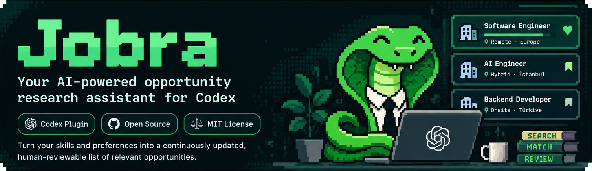
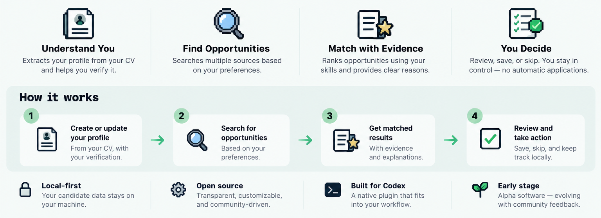

Jobra is a Codex-native skill for people who want
to explore job opportunities using a human-reviewed candidate profile. It turns
resume evidence and explicit search preferences into sourced opportunity
records, explainable matching assessments, and private reviewable results.

**Status: early development (`0.1.0-alpha.1`).** Candidate profile drafting and review,
live opportunity discovery, evidence-based matching, and saved results are
implemented. Semantic matching quality has not been independently established;
results need human review.

## What Jobra supports

- Extract text locally from PDF, DOCX, Markdown, and UTF-8 TXT resumes, then use
  Codex to draft an evidence-linked profile. Scanned PDFs and OCR are unsupported.
- Review, correct, confirm, or reject profile claims and verify a profile only
  after all sections and a separate final approval.
- Keep search preferences separate from the candidate profile; preferences must
  come from the user, not be inferred from a resume.
- Research real postings with Codex web tools after the user approves the
  search scope. Preserve source URLs, evidence, freshness, duplicates, and
  uncertainty in local snapshots.
- Compare a verified profile with validated opportunities using Codex for
  semantic interpretation and Python for deterministic validation, constraints,
  aggregation, and private result files.

Jobra does not provide a standalone backend, web server, database, mandatory
external LLM API, job-matching accuracy guarantee, or automatic applications.
It does not support a separate `research` workflow; use `discover` for supported
live opportunity research. A reachable posting is not proof the vacancy remains
open, and an unmentioned qualification is not proof the candidate lacks it.

## How it works and privacy



Jobra is a skill-first plugin. Codex handles conversation and semantic
interpretation; bundled Python scripts handle local text extraction, schema and
provenance checks, bounded planning, safe persistence, aggregation, and
rendering. Python does not scrape job sites or call an LLM API.

Runtime candidate data, preferences, opportunity snapshots, and results belong
in the selected workspace's ignored `.jobra/` directory, not in the plugin
package. Local storage does not mean Codex inference is offline; content given
to Codex is processed under the user's Codex account and service settings.
Before reading a personal resume or sending search terms externally, Jobra must
obtain the user's explicit approval for the source/data, destination, and
purpose. Users review recommendations and submit applications themselves.

## Install with Codex CLI

This procedure uses the local marketplace mechanism verified with Codex CLI
`0.162.1`. It copies only the plugin manifest and skill package to a persistent
local marketplace. It does not install Python dependencies. Automatic `$jobra`
skill discovery has not been conclusively verified; Desktop compatibility is
untested. Follow the [first-run guide](docs/first-run.md) for prerequisites,
commands, setup, and the verification boundaries.

The installed `SKILL.md` was manually confirmed accessible. That does not prove
automatic skill discovery or invocation. Start a fresh Codex session after
installation and check whether Jobra appears in the skill picker before relying
on it. Do not treat the repository's instructions as proof that an installed
skill was activated.

## Development and validation

Use Python 3 and the bundled runtime dependencies:

```sh
python3 -m venv .venv
.venv/bin/python -m pip install -r skills/jobra/requirements.txt
.venv/bin/python -m unittest discover -s tests -v
```

The full test suite was validated locally on Python 3.9.6, and CI targets Python
3.9. The minimum supported Python version has not been declared. For skill
frontmatter validation, run OpenAI Skill Creator's
`quick_validate.py skills/jobra` from the repository root. The [validation
notes](docs/validation.md) record the latest installation and discovery status.

## Limitations

- Matching explanations are Codex assessments, not independently validated
  predictions or calibrated hiring probabilities.
- Source pages may be inaccessible, stale, or ambiguous; application status can
  remain unknown. Remote listings do not establish work eligibility from a
  particular country.
- Plugin installation was verified through the Codex CLI local marketplace.
  Automatic skill discovery is inconclusive, and Desktop installation has not
  been tested.

## License

Jobra is distributed under the MIT License. See [LICENSE](LICENSE).

See the [candidate and search-preference contract](docs/candidate-data-contract.md),
[resume ingestion guide](docs/resume-ingestion.md), [opportunity discovery
guide](docs/opportunity-discovery.md), [matching workflow](docs/opportunity-matching.md),
and [profile review guide](docs/profile-review.md) for details.
